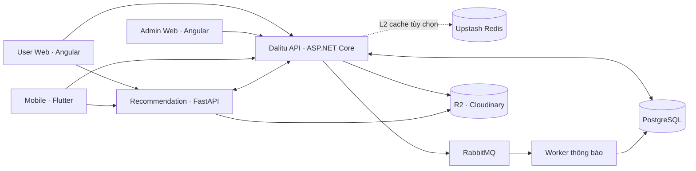

# Dalitu

Dalitu là nền tảng chia sẻ video trên Web và thiết bị di động. Người xem có thể khám phá video, theo dõi kênh và quản lý thư viện; nhà sáng tạo quản lý kênh, video và nội dung; quản trị viên vận hành hệ thống và kiểm duyệt. Nền tảng recommendation cá nhân hóa nguồn cấp dựa trên lịch sử tương tác.

Tên `HuTube` vẫn còn trong một số namespace, project và đường dẫn nội bộ do lịch sử phát triển.

## Chức năng tiêu biểu

- **Xem video:** trang chủ, khám phá, tìm kiếm, trình phát, lịch sử và tiếp tục từ vị trí đã xem.
- **Tài khoản và cộng đồng:** đăng ký/đăng nhập, phiên đăng nhập, kênh, đăng ký theo dõi, bình luận, thích/không thích và báo cáo nội dung.
- **Thư viện cá nhân:** playlist, xem sau, video đã thích và lịch sử xem.
- **Kênh sáng tạo:** quản lý kênh và video, tải video lên, xử lý các phiên bản media và gửi nội dung để kiểm duyệt.
- **Nguồn cấp đề xuất:** Collaborative Filtering; model đang phục vụ dùng Item-Based Cosine. Admin có thể xuất dữ liệu tương tác, huấn luyện và kích hoạt model mới.
- **Quản trị:** phân quyền RBAC, hàng đợi kiểm duyệt, xử lý báo cáo/khiếu nại, quản lý nội dung và theo dõi hoạt động hệ thống.
- **Thông báo và gói dịch vụ:** thông báo trong ứng dụng, email, push tùy cấu hình; hỗ trợ luồng gói thành viên và thanh toán SePay.

## Công nghệ và kiến trúc

| Thành phần | Công nghệ | Vai trò |
| --- | --- | --- |
| API | ASP.NET Core 10, EF Core | API dùng chung cho Web và Mobile; xác thực, nghiệp vụ, phân quyền và dữ liệu |
| Cơ sở dữ liệu | PostgreSQL 18 | Nguồn dữ liệu chính cho tài khoản, video, tương tác, moderation và giao dịch |
| User Web / Admin Web | Angular 20 | Giao diện người xem/nhà sáng tạo và giao diện quản trị |
| Mobile | Flutter | Ứng dụng người dùng trên Android/iOS |
| Recommendation | Python, FastAPI | Tính thứ tự video đề xuất từ model Collaborative Filtering |
| Hàng đợi | RabbitMQ | Xử lý bất đồng bộ việc phát tán thông báo sau quyết định kiểm duyệt |
| Cache phân tán | Upstash Redis REST, tùy chọn | Backend dùng Redis làm L2; cache in-process cho các dữ liệu này đã tắt |
| Lưu trữ media/model | Cloudflare R2, Cloudinary | Video và artifact model trên R2; ảnh qua storage adapter/Cloudinary |



Backend là một modular monolith theo các project Domain, Application, Infrastructure và API. Recommendation Service chạy riêng; Web, Mobile và Admin dùng chung API.

## Chạy local trên Windows

### Yêu cầu

- PowerShell 7.
- .NET SDK 10.
- Node.js 22.12 trở lên trong nhánh 22, npm và Chrome.
- PostgreSQL 18; hoặc Docker Desktop nếu dùng PostgreSQL trong Compose.
- Flutter stable 3.38.4 trở lên và Android SDK/emulator nếu chạy Mobile.
- Python 3.11–3.13 nếu chạy Recommendation Service.
- RabbitMQ nếu bật xử lý thông báo bất đồng bộ. Có thể chạy bằng WSL hoặc Docker.

### 1. Cấu hình và chuẩn bị cơ sở dữ liệu

Tại thư mục gốc repository:

```powershell
Copy-Item .env.example .env.local
```

Mở `.env.local` và đặt ít nhất:

- `ConnectionStrings__Database`: connection string PostgreSQL local.
- `Jwt__SigningKey`: chuỗi ngẫu nhiên dài ít nhất 64 ký tự.
- `RABBITMQ_PASSWORD` và `RabbitMq__Password`: cùng một mật khẩu local nếu bật RabbitMQ.
- `Recommendation__ServiceToken` và `Recommendation__AdminToken`: hai token riêng; Recommendation Service nhận cùng giá trị qua script chạy local.

`.env.local` chứa secret local và đã được Git bỏ qua. Không commit file này. Tạo role/database PostgreSQL theo [hướng dẫn local](docs/operations/LOCAL_DEVELOPMENT.md). Cấu hình mặc định trong tài liệu local dùng PostgreSQL tại `localhost:5432`, database `hutube`.

Sau khi PostgreSQL đã chạy và database đã được tạo, cài dependency và áp dụng migration:

```powershell
.\scripts\setup-local.ps1
```

Script restore backend, cài dependency cho hai ứng dụng Web và Mobile, rồi áp dụng migration vào database đã cấu hình.

### 2. Khởi động RabbitMQ

Có thể dùng Docker:

```powershell
docker compose --env-file .env.local up -d rabbitmq
```

Hoặc dùng Ubuntu WSL:

```powershell
.\scripts\setup-rabbitmq.ps1
```

RabbitMQ local dùng AMQP `127.0.0.1:5672`; trang quản lý Docker/WSL thường ở `http://127.0.0.1:15672`. Nếu không cần luồng thông báo qua queue, có thể đặt `RabbitMq__Enabled=false` trong `.env.local`.

### 3. Cài và chạy Recommendation Service

Tạo môi trường Python và cài package một lần:

```powershell
py -3.11 -m venv recommendation-service/.venv
.\recommendation-service\.venv\Scripts\python.exe -m pip install -e .\recommendation-service
```

### 4. Chạy các thành phần

Mở một cửa sổ PowerShell riêng cho mỗi lệnh:

```powershell
.\scripts\run-local.ps1 -Component api
.\scripts\run-local.ps1 -Component recommender
.\scripts\run-local.ps1 -Component user
.\scripts\run-local.ps1 -Component admin
```

| Thành phần | Địa chỉ |
| --- | --- |
| API | `http://localhost:5080` |
| Health check | `http://localhost:5080/health` |
| Swagger | `http://localhost:5080/swagger` |
| User Web | `http://localhost:4200` |
| Admin Web | `http://localhost:4201` |
| Recommendation Service | `http://localhost:8000` |

Để chạy Mobile trên Android emulator:

```powershell
.\scripts\run-local.ps1 -Component mobile
```

Script cấu hình địa chỉ API phù hợp cho emulator. Trên thiết bị thật, đặt `MOBILE_API_BASE_URL` trong `.env.local` thành địa chỉ LAN của máy chạy API.

Development gửi email xác minh/đặt lại mật khẩu vào thư mục pickup cục bộ được cấu hình bởi `Email__PickupDirectory`; không cần SMTP cho luồng này. Đăng nhập Google, lưu trữ cloud, FCM và Redis cần cấu hình thông tin dịch vụ tương ứng.

**Dùng Docker cho cả API, PostgreSQL và RabbitMQ:** sau khi đặt `POSTGRES_PASSWORD` và `RABBITMQ_PASSWORD` trong `.env.local`, có thể chạy:

```powershell
docker compose --env-file .env.local --profile api up --build -d
```

Compose chạy migration trước API. Khi dùng cách này, API đã chạy trong Docker ở cổng 5080; không khởi động thêm API bằng `run-local.ps1`. Hai ứng dụng Web, Mobile và Recommendation Service vẫn chạy riêng theo các bước trên. Xem thêm [hướng dẫn local đầy đủ](docs/operations/LOCAL_DEVELOPMENT.md).

## Các luồng chính

### Đề xuất video

1. Lượt xem, lượt thích, đánh giá và các tương tác liên quan được ghi vào PostgreSQL.
2. Admin yêu cầu cập nhật model; backend xuất ma trận tương tác lên Cloudflare R2 và gọi Recommendation Service.
3. FastAPI huấn luyện Item-Based Cosine, lưu artifact lên R2 rồi cập nhật manifest model đang hoạt động.
4. User Web/Mobile gọi feed đề xuất. Recommendation Service lấy ngữ cảnh và lịch sử xem từ API, xếp hạng video; API kiểm tra lại quyền truy cập và dựng dữ liệu video trả về client.
5. Khi chưa có model phù hợp hoặc Recommendation Service chưa sẵn sàng, hệ thống có feed dự phòng.

Model đang chạy được nạp vào bộ nhớ của Recommendation Service; artifact được lưu trên R2. Redis không phải nơi lưu model đề xuất. Xem [kiến trúc Collaborative Filtering](docs/architecture/CF_ARCHITECTURE.md) và [Recommendation Service](recommendation-service/README.md).

### RabbitMQ và thông báo sau kiểm duyệt

1. Admin duyệt hoặc từ chối video. Trong cùng transaction PostgreSQL, API lưu trạng thái video, quyết định, audit log và một sự kiện outbox.
2. API trả kết quả sau khi transaction thành công; publisher nền gửi sự kiện outbox sang RabbitMQ và chỉ đánh dấu đã gửi sau khi broker xác nhận.
3. Consumer nhận sự kiện, xử lý danh sách người đăng ký theo từng lô, rồi ghi inbox và các công việc gửi thông báo vào PostgreSQL.
4. Worker gửi thông báo realtime qua SignalR, email theo cài đặt người dùng và push qua FCM nếu đã cấu hình.
5. Khi broker hoặc dịch vụ gửi thông báo gặp lỗi, công việc được thử lại; message không hợp lệ hoặc vượt giới hạn retry được chuyển vào dead-letter queue.

Luồng dùng outbox để quyết định kiểm duyệt không bị mất nếu RabbitMQ tạm thời không khả dụng. Giao nhận tới dịch vụ bên ngoài theo kiểu at-least-once. Chi tiết tại [Moderation và RabbitMQ](docs/features/Moderation_RabbitMQ.md).

### Redis

Redis được cấu hình tùy chọn qua `UPSTASH_REDIS_REST_URL` và `UPSTASH_REDIS_REST_TOKEN`. Các cache dữ liệu phía server dùng Upstash làm L2; API không giữ bản sao L1 trong RAM tiến trình.

- API dùng HybridCache với local cache bị tắt cho DTO đọc được cho phép, notification pages và snapshot counter; khóa DTO phân phạm vi user/public và gắn với revision dữ liệu.
- Recommendation Service lưu ranking ID theo model version, user và danh sách loại trừ trong Redis tối đa 30 giây. Nếu Redis chưa cấu hình hoặc lỗi, service tính thứ hạng từ model đã nạp.
- Player lưu tùy chọn âm lượng/tắt tiếng theo session trong hash Redis; khóa hết hạn cùng session. Khi refresh token, tùy chọn được chuyển sang session mới.
- API lưu GeoIP đã tra cứu, số liệu usage từ provider, cooldown recommendation và marker lấy mẫu audit trong Redis với TTL ngắn. API không giữ các bản sao này trong cache RAM cục bộ.
- Data Protection có thể dùng key ring được mã hóa và lưu trong namespace riêng trên Redis.

PostgreSQL vẫn là nguồn dữ liệu chính và nơi API xác thực session. API đọc `read_cache_revisions` trước DTO cache lookup; một cache hit vì vậy vẫn có truy vấn nhỏ tới PostgreSQL. Khi Redis chưa cấu hình hoặc tạm thời lỗi, DTO và notifications quay về nguồn, recommendation được tính lại, GeoIP và usage được hỏi lại từ provider, còn tùy chọn player dùng mặc định và không được lưu. Giao diện Web/Mobile vẫn giữ trạng thái trình phát trong bộ nhớ phía client. Xem [chi tiết cache Redis](docs/operations/REDIS_READ_CACHE.md) và [player preferences](docs/operations/SESSION_PLAYER_PREFERENCES.md).

## Cấu trúc repository

```text
backend/                 API ASP.NET Core, Domain/Application/Infrastructure và tests
frontend/user-web/       Angular Web cho người dùng và nhà sáng tạo
frontend/admin-web/      Angular Web quản trị
mobile/user-app/         Flutter Mobile App
recommendation-service/  FastAPI, Collaborative Filtering và pipeline huấn luyện
database/                Full schema-only export từ Neon (2026-11-06)
docs/                    Kiến trúc, nghiệp vụ, API và vận hành
scripts/                 Script local, migration, test và triển khai
docker-compose.yml       PostgreSQL, RabbitMQ và profile API local
```

## Tài liệu liên quan

- [Local development](docs/operations/LOCAL_DEVELOPMENT.md) · [Local PostgreSQL](docs/operations/LOCAL_SETUP.md)
- [Module người dùng](docs/features/Module_NguoiDung.md) · [Module quản trị](docs/features/Module_QuanTri.md)
- [Kiến trúc Collaborative Filtering](docs/architecture/CF_ARCHITECTURE.md) · [Recommendation Service](recommendation-service/README.md)
- [Cache Redis](docs/operations/REDIS_READ_CACHE.md) · [RabbitMQ moderation](docs/features/Moderation_RabbitMQ.md)
- [Tải và xử lý video](docs/operations/VIDEO_UPLOADS.md) · [API auth/session](docs/api/S4_AUTH.md)
- [Tech stack](docs/architecture/TECH_STACK.md)
